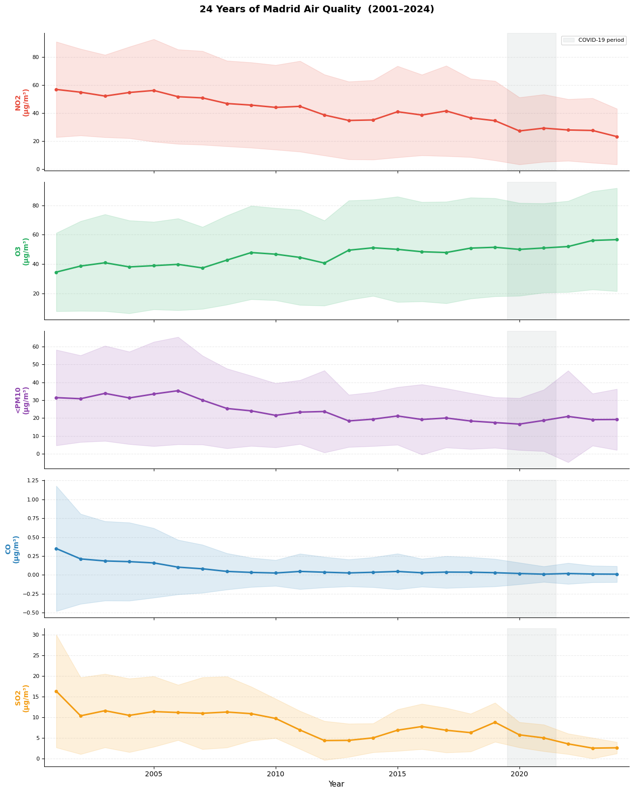
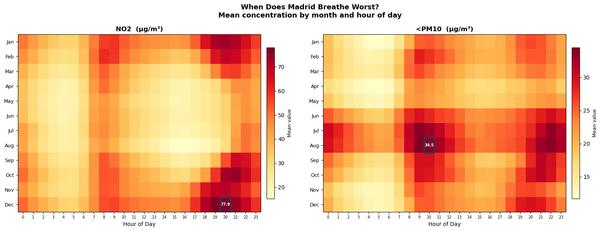
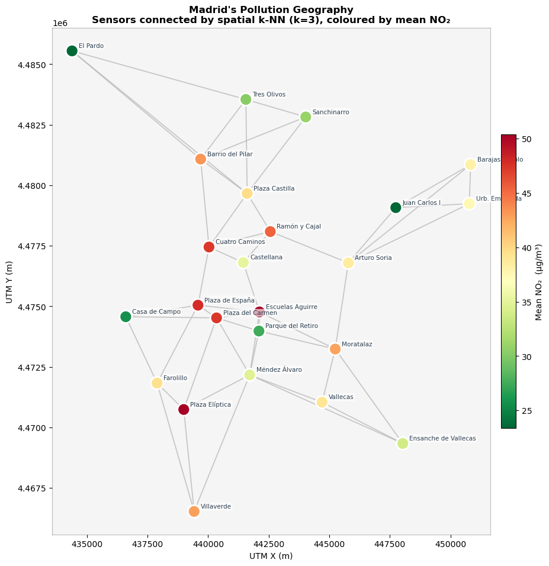
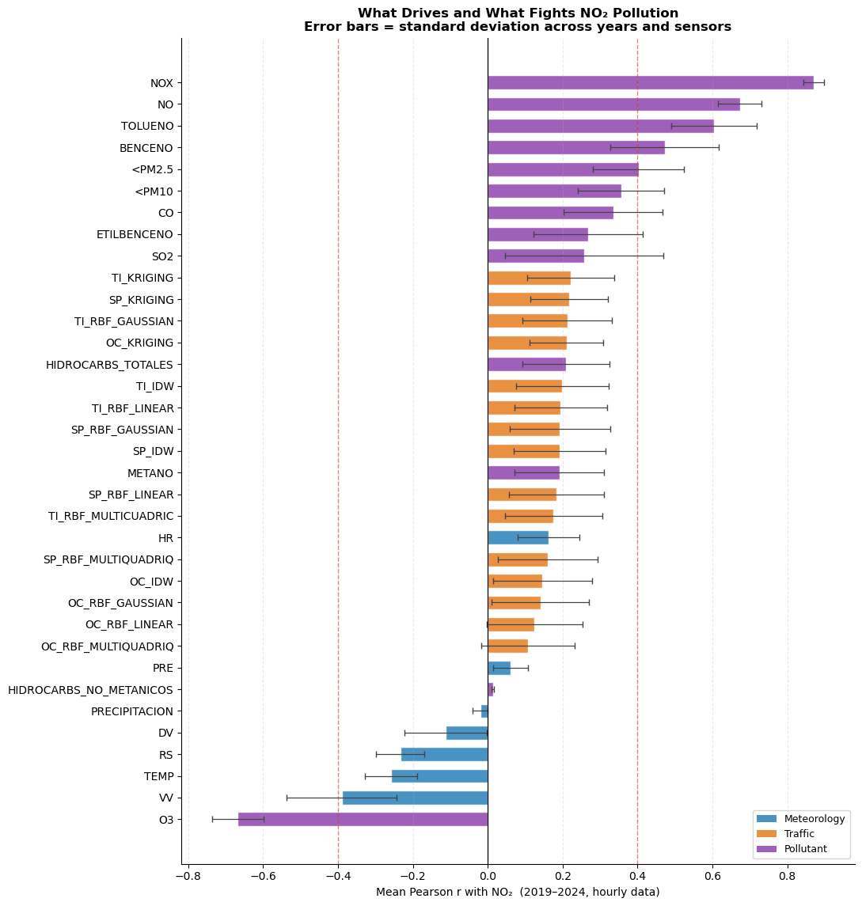
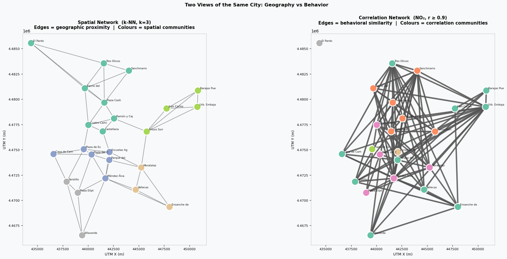
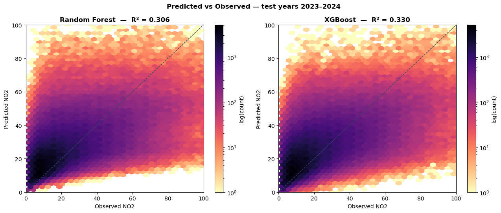
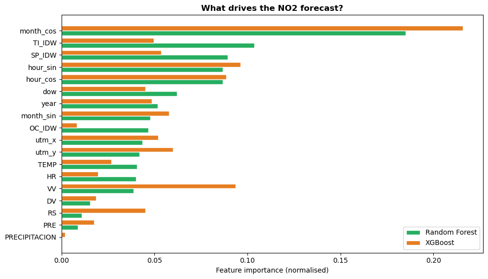

# Madrid Air Quality, 2001–2024: Data Quality, Sensor Networks and NO₂ Forecasting

**Research question:** What drives air pollution in Madrid, and can hourly NO₂ be forecast from weather and traffic?

**Completed:** May 2026 · **Data:** METRAQ, hourly readings from 24 stations, 2001–2024 (~64M rows) · **Methods:** imputation, time-series decomposition, graph analysis, parallel computing, random forest and XGBoost



> **Key findings**
> - **NO₂ fell by more than half** between 2001 and 2024 (annual mean from about 57 to 23 µg/m³). CO and SO₂ dropped too. **Ozone went the other way**, rising steadily, because less NO is left to destroy it.
> - Pollution follows people: NO₂ peaks at the **morning and evening rush hours**, is worst on **winter evenings**, and falls 15–25% at weekends.
> - Madrid's sensors move together: the **median correlation between stations' NO₂ is 0.875**. Behavioural communities of sensors don't match geographic ones.
> - A gradient-boosted model forecasts hourly NO₂ for **two unseen years** (2023–2024) with R² = 0.33, against −0.04 for a naive baseline. **Season, traffic and time of day** drive the prediction.

**Stack:** Python · pandas · scikit-learn · XGBoost · NetworkX · multiprocessing · Parquet · matplotlib

**[Open the full notebook →](https://nbviewer.org/github/Francydc04/madrid-air-quality/blob/main/madrid_air_quality.ipynb)** (opens in nbviewer, since GitHub may not render a notebook this size)

---

## Data

The [METRAQ Air Quality dataset](https://huggingface.co/datasets/dmariaa70/METRAQ-Air-Quality) (María-Arribas et al.) holds hourly readings from Madrid's monitoring network from January 2001 to December 2024: up to 14 pollutants, 7 meteorological variables, and traffic intensity, speed and occupancy interpolated to each station. It's about 15 GB in memory and downloads automatically on the first run.

Raw sensor data is messy, so the first step was understanding it. More than half of every meteorological series was filled in by METRAQ's own interpolation, against under 5.5% for pollutants. Some gaps last up to three years. Values outside physical and EU-regulatory bounds cluster in a few variables (pressure, NO and NOX), with a large share in interpolated records.

## What the analysis covers

| Section | Question | Methods |
|---|---|---|
| 1–2. Data quality | How complete and trustworthy is the data? | Missingness mapping, gap detection, validity bounds |
| 3. Imputation | Can we fill gaps better than the dataset's own interpolation? | Grouped mean, forward/backward fill, per-sensor regression, compared with MAE, RMSE and Kolmogorov–Smirnov distance |
| 4. Temporal patterns | How does pollution change over years, seasons, weeks and hours? | Trend, seasonal, weekly and diurnal decomposition |
| 5. Spatial network | How is the sensor grid organised in space? | k-NN graph, minimum spanning tree, centrality, modularity communities |
| 6. Correlation network | Which sensors behave alike, regardless of distance? | Pearson correlation graph, threshold sweep, community comparison |
| 7. Parallel computing | How fast can we compute 576 correlation matrices? | Year-partitioned Parquet, `multiprocessing.Pool` |
| 8. Forecasting | Can weather and traffic predict NO₂ two years ahead? | Random forest vs XGBoost, chronological train/test split |

## Key findings

**When the air is worst.** NO₂ peaks at 07:00–09:00 and 19:00–21:00, the commuting windows, and the worst hours of the year are winter evenings. PM10 behaves differently, peaking in summer.



**Where it's worst, and what drives it.** Station averages range from about 24 to 50 µg/m³ of NO₂, with central and traffic-heavy stations at the top. Across 2019–2024, NO₂ moves with other combustion pollutants and traffic, and against ozone (r ≈ −0.66), wind speed and temperature: windy, warm hours disperse it.

<p>
  
  
</p>

**Geography isn't behaviour.** Connecting sensors by distance gives five clean geographic communities (modularity 0.51). Connecting them by how similarly their NO₂ moves gives a far denser, less partitioned network (modularity 0.12). City-wide weather and traffic matter more than which district a station is in.



**Forecasting.** Trained on 2019–2022 and tested on 2023–2024, both models beat the baseline by a wide margin. XGBoost does slightly better.

| Model (test years 2023–2024) | MAE (µg/m³) | RMSE (µg/m³) | R² |
|---|---:|---:|---:|
| Mean baseline | 17.89 | 22.14 | −0.04 |
| Random forest | 13.08 | 18.08 | 0.31 |
| **XGBoost** | **12.77** | **17.77** | **0.33** |



Seasonality (`month_cos`) is the strongest predictor for both models, followed by traffic intensity and speed and the hour of the day. XGBoost leans more on wind speed (`VV`).



**Parallel computing.** Splitting the data into 24 yearly Parquet files and computing 576 correlation matrices in parallel cut runtime from 16.0 to 7.8 seconds (2.1× speedup). Gains are capped because every worker reads from the same disk.

## Limitations

- R² of 0.33 means most hour-to-hour variation in NO₂ remains unexplained. The model uses only weather, traffic and calendar features: no emissions data, no lagged pollution values.
- Meteorological series are heavily interpolated in the source data. Series more than 80% interpolated were excluded from the model, which removes much of the weather signal.
- Imputation methods can only be compared against METRAQ's own interpolation, not against ground truth, because the true values of missing hours are unknown.
- Correlations describe co-movement, not cause and effect.

## Run it

```bash
pip install -r requirements.txt
jupyter notebook madrid_air_quality.ipynb
```

- The first run downloads the full dataset from Hugging Face (~15 GB). Allow 16 GB of RAM and 15–25 minutes end to end.
- Section 7 writes year-partitioned Parquet files and a small worker module (`task8_worker.py`) to a `task8/` folder. The module exists because, on macOS, `multiprocessing` can't import functions defined inside a notebook.
- Section 9 saves the five summary figures to `task10/`.
- Random seeds are fixed (`random_state=42`).

```
├── madrid_air_quality.ipynb   full analysis, with outputs
├── images/                    figures used in this README
├── requirements.txt
└── README.md
```

---

<sub>Francesca D'Aloia Cascone, with Andrea Scarso. Developed for the Advanced Coding for Data Analytics course at LUISS Guido Carli, 2025/26.</sub>
